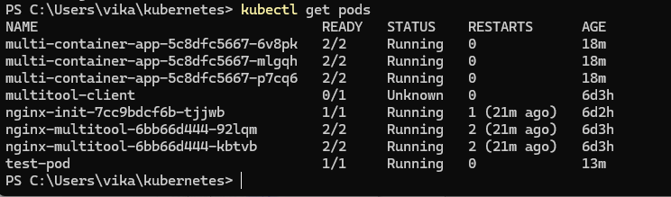
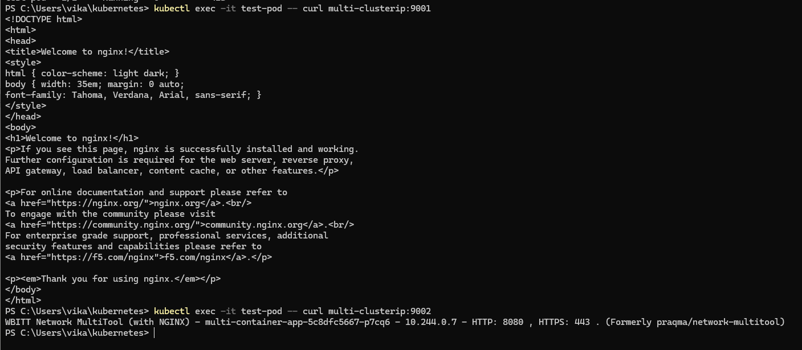
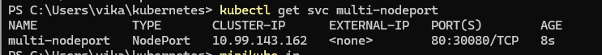
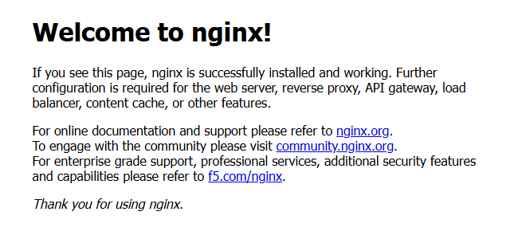
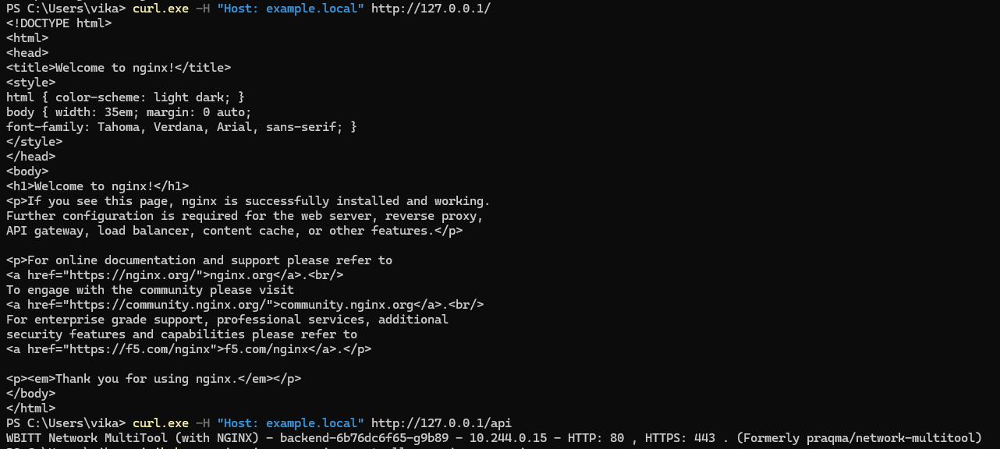

# Домашнее задание к занятию «Сетевое взаимодействие в Kubernetes»

## Задание 1

### Манифесты
- [deployment-multi-container.yaml](https://github.com/ryltsevavikyla-coder/kubernetes_2/blob/main/deployment-multi-container.yaml)
- [service-clusterip.yaml](https://github.com/ryltsevavikyla-coder/kubernetes_2/blob/main/service-clusterip.yaml)
- [service-nodeport.yaml](https://github.com/ryltsevavikyla-coder/kubernetes_2/blob/main/service-nodeport.yaml)

### Скриншоты

**Поды Deployment (3 реплики):**

**Проверка ClusterIP изнутри кластера (curl на 9001 и 9002):**

**Service NodePort:**

**Доступ к NodePort с локального компьютера (страница nginx):**

## Задание 2

### Манифесты
- [deployment-frontend.yaml](https://github.com/ryltsevavikyla-coder/kubernetes_2/blob/main/deployment-frontend.yaml)
- [deployment-backend.yaml](https://github.com/ryltsevavikyla-coder/kubernetes_2/blob/main/service-backend.yaml)
- [service-frontend.yaml](https://github.com/ryltsevavikyla-coder/kubernetes_2/blob/main/service-frontend.yaml)
- [service-backend.yaml](https://github.com/ryltsevavikyla-coder/kubernetes_2/blob/main/service-backend.yaml)
- [ingress.yaml](https://github.com/ryltsevavikyla-coder/kubernetes_2/blob/main/ingress.yaml)

### Скриншоты

**Доступ через Ingress на путь `/` (frontend) и Доступ через Ingress на путь `/api` (backend):**

